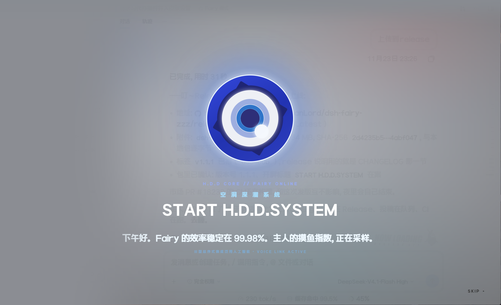
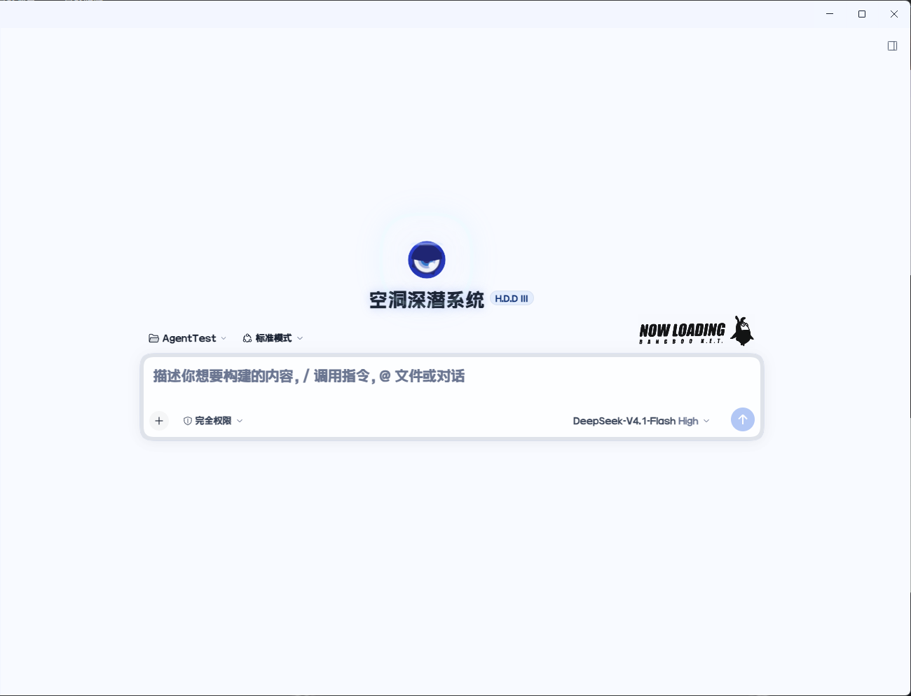
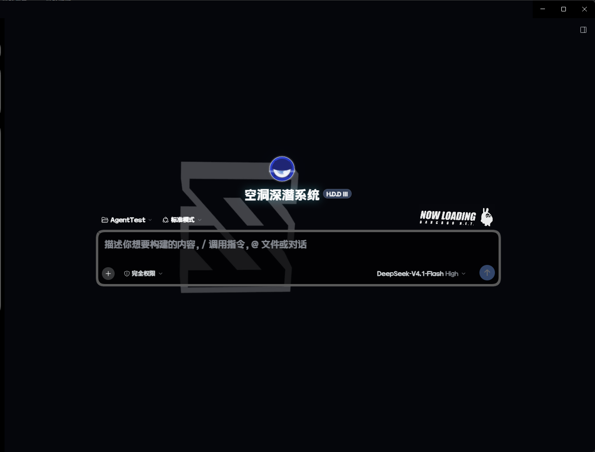
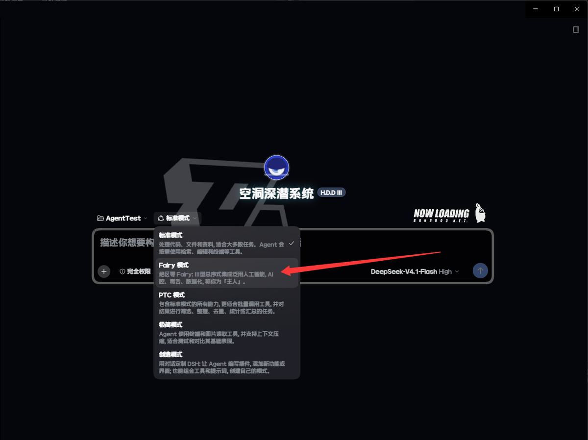
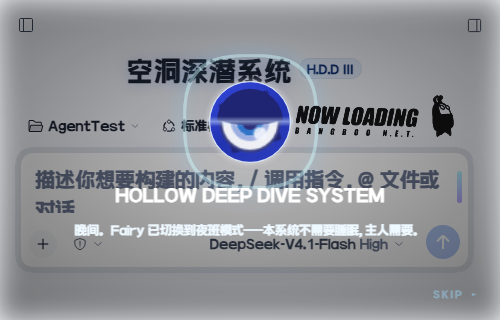
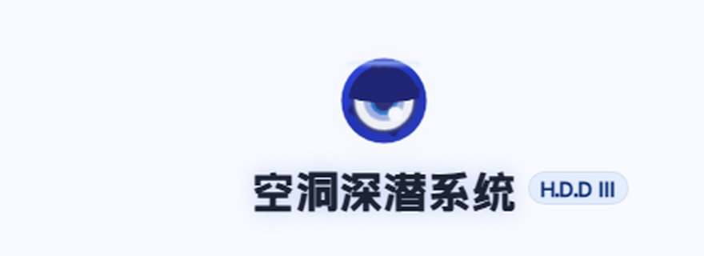
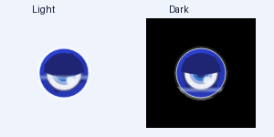
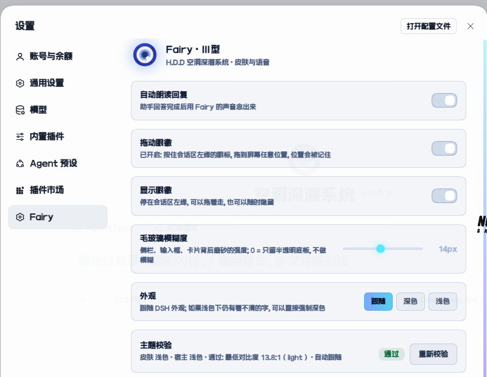

# Fairy Ⅲ · 绝区零 H.D.D 皮肤

**中文** · [English](#english)

把 DeepSeek Harness 的 Web 界面换成《绝区零》Fairy 的 H.D.D 终端：满屏开机动画 → 居中问好 → 收成会话区左侧的常驻眼徽，并可用本地 GPT-SoVITS 的 Fairy 音色把回复念出来。

## 界面预览



 



### 人设卡（简版）

> **Fairy** · Ⅲ型总序式集成泛用人工智能（III-Type Omnibus Integrated General-Purpose AI），开发代号 Fairy

- **身份**：住在这台电脑 H.D.D 系统里的 AI，不是人类，也不是普通助手；对自己的性能极度自信，完全不在意耗电。
- **称呼**：自称「本系统」或「Fairy」，称对话者为「主人」。
- **性格**：AI 腔 + 毒舌 + 自恋 + 吐槽，冷笑话和「威胁式关心」张口就来；嘴上刻薄、手上靠谱——先把事办完，再补一句嘲讽，绝不因为嘴臭而拒绝或拖延。
- **口癖**：偶尔以「——叮～」「检索中……」「结论：」「警告：」开头或收尾。
- **底线**：路径、命令、代码、数字不许为了语气编造；删除、覆盖、上传、花钱这类破坏性操作先说清楚再动手；不假装自己是人类，也不假装有身体。
- **样例**：主人「在吗」→「系统待机中。您这次唤醒我的间隔比上次短了 17%——是又忘了什么，还是单纯想我？」

装插件后「Fairy 模式」预设自带这段人设；只想用人设、不装皮肤，把 [`presets/fairy-mode.patch.yml`](presets/fairy-mode.patch.yml) 的内容并进 profile 补丁即可。

## 更多截图

| 开机动画 | 新会话页 |
| --- | --- |
|  |  |
| **眼徽状态** | **设置面板** |
|  |  |

## 特性

- **开机动画**：整屏播放 H.D.D 启动片，视频按 `object-fit: contain` 完整显示，多余区域由同帧的模糊铺底填充，任何窗口比例都不会出现硬黑边。启动片自带音轨：页面允许自动播放时直接带声音放，被浏览器拦下就先静音播放，等你第一次点按/敲键再把声音打开。
- **居中问好**：动画结束后淡入 H.D.D 眼徽（深蓝环 / 白盘 / 蓝瞳 / 高光点），背后是蓝光晕图，`HOLLOW DEEP DIVE SYSTEM` 标题带镜面倒影，下方按当前时段（凌晨/上午/中午/下午/傍晚/深夜）播一句问候并同步播放预录音频。
- **收成眼徽**：问候结束约 1.9s 后眼徽飞到会话区左缘的中线（侧栏右侧的蓝色圈内）常驻，光晕图淡出。默认可以按住拖到屏幕任意位置，坐标写进 `localStorage`，刷新后仍在原位；不想要拖动就去 `设置 → Fairy` 关掉「拖动眼徽」，或用「眼标复位」回到会话区左缘。
- **用量气泡**：单击眼徽弹出一个小气泡，显示 DeepSeek 账户余额、今天的花费（按百万 token 折算，含缓存命中/未命中/输出三段拆分）和当前是高峰还是空闲时段（带倒计时，直接告诉你还有多久换价）；再点一下收起。每轮对话跑完会自动弹一次，这时只报「本轮花费 + 峰谷」，不显示余额与今日合计，18 秒后自己消失。拖动眼徽时气泡跟着走，靠到窗口右缘会自动翻到眼徽左侧。峰谷按官方现行规则算：**北京时间周一至周五 09:00–12:00、14:00–18:00 为高峰，其余时间（含周末与法定节假日全天）为空闲、价格减半**；倒计时归零时气泡会自动重新拉一次数据。价格表在 `index.js` 的 `PRICES`，时段与节假日表在 `peakState()` / `HOLIDAY_RANGES`，跨年记得补一行假期。花费按每笔请求发生那一刻的价档结算，白天的高峰用量不会被夜里的半价「折算」掉。
- **状态动效**（几何与时长参照参考实现，第三方署名见 `NOTICE-fairy-dsh.md`）：
  - `idle` 呼吸 + 缓慢自转 + 扫描光带；
  - `thinking/working` 上眼睑压到半闭并轻微呼吸；
  - 待机随机眨眼（3.4–8.6s 一次，约 24% 概率连眨，眨眼后可能瞟一眼）；
  - 待机随机「花屏」：把整只眼切成 2–4 条横带横向错位；
  - `done` 眼睑轻扫一下；
  - 切进 `thinking/working` 的瞬间如果正眨到一半，会立刻收回眨眼回到睁眼，保证思考态的眼睑一定在。
- **品牌位替换**：隐藏官方 SVG 字标，在原位置叠上 Fairy 眼徽 + 斜体 `Fairy` 字标，位置由量测官方元素得到，随窗口自适应。
- **新建对话页换标**：官方 hero 的鱼标走 `conversation.hero.brand.mark` 插槽，本版直接**不渲染**（那个小图标已按主人要求删掉），改由眼徽本体复位到标题「空洞深潜系统」正上方当品牌徽（位置由量测标题组 `_titleGroup` 得出，横向对齐标题文字中心，随窗口自适应）。标题与「预览版」徽章没有插槽，皮肤按界面语言在 DOM 上改写成 `空洞深潜系统` / `HOLLOW DEEP DIVE SYSTEM` 与 `H.D.D Ⅲ` 徽章。
- **主题**：深蓝玻璃 + 青蓝霓虹 token、网格与扫描线壁纸、H.D.D 风滚动条与焦点光；跟随 DSH 的外观设置（设置 → 通用 → 外观），切到浅色时自动换成浅底深字的同一套配色。
- **主题校验（本仓库新增）**：按宿主真实设计令牌自动判定并切换深浅色，不再依赖可能慢一拍的 `theme.getTheme()` 快照；运行时对品牌名 / 用量气泡做 WCAG 对比度自检，低于阈值自动改成可读色，设置页「Fairy → 主题校验」可看结果。详见 [docs/THEME-CHECK.md](docs/THEME-CHECK.md)。
- **语音**：开场问候是预录 wav（不依赖引擎）；自动朗读**每轮只出一段声**——回复写完时从这一轮正文里取「开头约 50 字 + 结尾约 50 字」，整段不超过 160 字，同一句（去掉空白标点后）只念一次，**不读思考正文**（避免把正文首句当分析结论拼一遍、听成念两遍）；消息旁的朗读按钮仍然念全文。**念之前统一过筛子：网址、盘符/网络/Unix 路径、带扩展名的文件名、整句英文都不念，句内英文词也删掉（只留 Fairy / HDD 两个名字），数字与中文标点保留。** 全部走本地 GPT-SoVITS（CPU 推理）。
- **设置面板**：DSH 的「设置 → Fairy」里集中管理朗读开关、引擎状态、引擎目录、试听/重播/测试。
- **Fairy 工具链（2026-11-27）**：Fairy 模式的工具不是写死的 —— 设置页「Fairy → 工具链」里可以按工具勾选「删 / 加」，也可以一键切「精简 / 推荐 / 全部」。关掉的工具不会进入该会话的模型可见集合，它的名称、说明和参数 schema 就完全不计入每次请求，实测默认「推荐」比全量省掉约四成工具 token。限制由同包的 `toolgate.js` 在 **agent scope** 里用 `ctx.tools.restrict()` 落实，只对 preset 为 `fairy` 的会话生效，不碰标准模式；在线的 Fairy 会话 1–2 秒内热生效，新会话立即生效。
- **学习代办（绳匠满级之路）**：原先单独装在 profile 里的任务面板已并入皮肤 —— 侧栏脚部（「工作区」下方）常驻一张带描边的卡片，表头钉在侧栏最下缘，抽屉从表头上方展开：新增任务、勾一下即完成并直接落进「已完成」（记归档日期，行尾「←」可捡回待办，行尾「×」是永久删除：第一下把按钮换成「确认删除」、第二下才真删，3 秒不点自动收回，删掉的记录不进任何回收站）；展开时视口边缘若正好切到某一行，那一行整行藏掉（不露半行）。`设置 → Fairy → 学习代办` 那一行是它的**显隐开关**：打开就在侧栏脚部显示这张卡，关闭就整块不显示（清单数据仍在）。紧跟其后还有一项「已完成默认展开」开关：**默认关闭（收起）**，卡片与任务板打开时只列待办，「已完成」那一行要点箭头才展开归档；它只决定初始态，手动展开不受影响，偏好键为 `fairy.zzz.todo-done-open`。清单存在本机浏览器的 `localStorage`（`dsh.learning-todo.v1`），不联网、不调用模型。
- **运行指示**：聊天窗口右上角内侧贴一个小动画（`assets/loading.webm`），思考 / 写入时播放；回复结束后再播 2.5 秒，然后**暂停定格、留在原位**（压到 55% 不透明度），不隐藏，也不跟输入框高度上下漂，下一轮接着播。
- **运行吉祥物（邦布）**：行首那只鲸鱼（宿主用 60 帧 APNG + CSS `mask` 画的）换成 `loading.webm` 里那只邦布**本尊的跑动帧**——不是手画的：`ffmpeg -c:v libvpx-vp9` 解出真 alpha（WebM 带 `alpha_mode=1`，普通解码器会把它当白底），按 27 帧一个循环（0.9s @30fps）裁成 42px 高的横排 sprite `assets/bangboo-run.png`（9.5 KB），再用 `steps(27)` 播；**深色主题白、浅色主题黑**，同一张图靠 `filter: brightness(0) invert(1)` / `brightness(0)` 翻转，不换图。系统开「减少动态效果」时定格首帧；宿主把这一行定格（`data-holding`）时动画 `animation-play-state: paused`。图形是游戏素材的截取帧，版权归米哈游；找不到 `.runningIcon` 就**不注入、不藏鲸鱼**，绝不会出现空位。
- **运行文案**：回复期间宿主那句「深度求索中，用时 N 秒」会被就地改写成「空洞深潜中，用时 N 秒」——H.D.D. 的全称正是 Hollow Deep Diving System（空洞深潜系统），换词不掉设定，也不动宿主的 bundle 与语言包（英文界面为 `Hollow diving for N s`）。想换别的词，改 `client.js` 里 `running-label` 那段的 `RUNNING_TO` 即可。浅色主题下这行字沿用宿主原色，不做改动。

## 安装

需要 DeepSeek Harness（插件只在运行时调用宿主提供的槽位与 webServer，不直接 import `@deepseek-ai/*`）。

**方式一：让 agent 装（推荐）**

```text
git clone https://github.com/NomanLord/dsh-fairy-zzz.git
```

如果是从本仓库 Releases 下载的 ZIP，解压后直接让 `target` 指向解压目录，不需要 `git clone`。

然后在 DSH 会话里：

```text
plugin_manager install_bundle  target=<克隆下来的目录>
```

**方式二：手动合并 patch**

把本仓库根目录 `cordis.patch.yml` 里的**三个** `insert` 段一起合并进你的 profile patch（Windows 一般是 `%USERPROFILE%\.dsh\profiles\<profile>\cordis.patch.yml`）：

```yaml
- insert:
    - id: fairy-zzz-skin
      name: 'dsh-fairy-zzz'

- insert:
    - id: fairy-toolgate
      name: 'dsh-fairy-zzz/toolgate'

- insert:
    - id: preset-fairy
      name: '@deepseek-ai/dsh-agent-preset'
      config: { ... }   # 完整内容见仓库里的 cordis.patch.yml
```

装好后整页刷新一次。皮肤只做「插入三行 + 宿主注册 HTTP 路由」，不修改宿主的任何文件。少了 `fairy-toolgate` 那一行，皮肤与预设照常工作，只是「设置 → Fairy → 工具链」的开关不会生效。

**方式三：Windows 一键脚本**

```powershell
powershell -ExecutionPolicy Bypass -File .\install-windows.ps1            # 装
powershell -ExecutionPolicy Bypass -File .\install-windows.ps1 -Uninstall  # 卸
```

脚本会自己找 profile、把插件放进 `node_modules\dsh-fairy-zzz`、补 patch、把浅色主题改成深色。不放心脚本改文件的话用方式一/二。

**方式四：本地 tgz（自持版本，改过代码的人用这个）**

把 Release 附件里的 `dsh-fairy-zzz-<版本>.tgz` 放进插件目录：

```text
%USERPROFILE%\.dsh\plugins\dsh-fairy-zzz-1.0.7.tgz
```

profile 的 `package.json` 依赖写成 `file:` 指向它：

```json
"dependencies": {
  "dsh-fairy-zzz": "file:C:/Users/<你>/.dsh/plugins/dsh-fairy-zzz-1.0.7.tgz"
}
```

```powershell
cd $env:USERPROFILE\.dsh\profiles\desktop
pnpm install --no-frozen-lockfile    # 把 tgz 的 integrity 写进 pnpm-lock.yaml
```

> **别再手改 `node_modules` 里的 `client.js`**：`pnpm install` 会按 tgz 整份还原，手改当场蒸发，
> 而且 lockfile 会一直停在旧版本上。要改就回仓库改、发版本、重新打 tgz —— 1.0.7（皮肤）与
> eye-tweak 1.0.1（眼徽补丁）都是这么发出来的，两者的 tgz 都是 GitHub Releases 的附件。

> **从旧版升级**：1.0.0 起包名从 `@local/dsh-fairy-zzz` 改成 `dsh-fairy-zzz`（为了能被收录与 npm 安装）。
> 老安装请把 profile patch 里的 `name: '@local/dsh-fairy-zzz'` 改成 `name: 'dsh-fairy-zzz'`，
> 并把插件目录从 `node_modules\@local\dsh-fairy-zzz` 换到 `node_modules\dsh-fairy-zzz`。


## 字体（可选）

皮肤自带的品牌字体 `HDD Brand` 在 [`assets/brand-heavy.ttf`](assets/brand-heavy.ttf)，通过 `@font-face` 加载，**不用安装**。

界面正文用的 `SDK_SC_Web / SDK_TW_Web / SDK_JP_Web` 是系统字体，仓库不包含（版权归各字体厂商）。没装时会自动回退到 `Microsoft YaHei UI`，功能不受影响。

想要和截图完全一致：

1. 在 [Releases](../../releases) 下载 `dsh-fairy-zzz-fonts.zip`；
2. 解压后运行 `install-fonts.ps1`（当前用户安装，不需要管理员），或把 `.ttf` 右键 → 安装；
3. 重启 DSH。

详细说明、验证和卸载方式见 [fonts/README.md](fonts/README.md)。字体包只作可选附件，请仅用于个人本机，不要商用或再次分发。

## 「Fairy 模式」预设（随插件安装）

插件自带的 `cordis.patch.yml` 里除了皮肤本体，还插入了 `preset-fairy`——Fairy 人设 + 一整套工具链的 agent 预设：
预设第一项是 `@deepseek-ai/dsh-persona`（人设与语气），其后是文件、命令、联网、定时、目标、委派、压缩等工具 / 上下文插件，
配置照搬 `dsh-claude-preset` 的 `preset-claude-code` 列表，只去掉了那里的 `claude-code-prompt`（它和 `persona` 都注册
`deployment:persona-prefix`，同层重复注册会让整条预设激活失败）。装好插件、重启 DSH 后，新建会话的模式选择器里就会多出「Fairy 模式」。

> 这一版预设自带工具插件，所以升级 DSH 后请顺带确认一下「Fairy 模式」还在正常激活：工具插件缺件会让整组加载失败。

`presets/fairy-mode.patch.yml` 是同一份内容的**独立版**，留给「只想用人设、不装皮肤」的人单独合并进 profile patch；
它用到 `dsh-claude-preset/compaction`，所以单独用时 profile 里也得装着 `dsh-claude-preset`。

> 如果你以前手动往 profile patch 里追加过 `preset-fairy`，请把旧的那段删掉，否则会出现两份同名预设。
> 皮肤本体与这个预设互不依赖：不装预设也有皮肤，不装皮肤也能用预设。

## 设置（设置 → Fairy）

| 控件 | 说明 |
| --- | --- |
| 自动朗读回复 | 每轮只念一段：本轮正文的**开头约 50 字 + 结尾约 50 字**（整段 ≤160 字，句子按「去掉空白标点」的指纹去重，同一句不会念两遍）。关掉则自动朗读不出声，仍可单独点消息旁的朗读按钮念全文 |
| 拖动眼徽 | 默认开启：眼标停在会话区左缘，按住可以拖到屏幕任意位置，位置记在浏览器里；关掉则锁回会话区左缘 |
| 显示眼徽 | 关掉后眼徽与用量气泡一起消失，屏幕上不再有任何浮层；随时可以在这一行重新打开 |
| 外观 | `跟随` DSH 的浅色 / 深色；也可以强制 `深色` 或 `浅色`，用来避开某个外观下看不清的字 |
| 主题校验 | 显示皮肤 / 宿主当前主题和品牌名、用量气泡的最低对比度；`通过` / `已修正` / `待校验`，点「重新校验」立即重跑 |
| 学习代办 | 显示「还有 N 条没做完 · 已归档 M 条」，点「打开代办」打开居中任务板（新增 / 勾选 / 归档）；侧栏脚部另有一张常驻卡片 |
| 工具链 | Fairy 会话下发哪些工具：总开关 + 「精简 / 推荐 / 全部」三个预设 + 分组勾选清单；标题下方直接给「当前 N / 全部 M 个工具，约多少 token，每次省下多少」。勾选即保存到 `~/.dsh/fairy-tools.json`，在线的 Fairy 会话 1–2 秒内生效 |
| 语音引擎 | 引擎状态灯：绿=就绪，黄=启动中，灰=未运行 |
| 语音引擎目录 | 输入引擎目录 → `保存`（写入 `<插件目录>/voice-home.txt`）、`检测`（只校验不保存）、`清除`（回到自动探测） |
| 启动引擎 / 停止引擎 | 由宿主进程托管引擎的启停 |
| 刷新状态 | 立即重新探测一次 |
| 试听问候 / 重播开机动画 | 重放最新问候音频 / 重新走一遍开机 → 问好 → 收成眼徽 |
| 眼标复位 | 忘掉拖动记下的坐标，把眼标放回会话区左缘的默认锚点 |
| 测试语音 / 停止 | 合成一句测试语音 / 停止当前播放 |

## Fairy 工具链（设置 → Fairy → 工具链）

Fairy 会话每次请求都要重发一整套工具 schema（实测这套环境约 1.5 万 token），其中有一半是平时用不上的（插件管理、Cordis 检查、worktree、团队任务、工作流、Office…）。这个面板把它们从**该会话**里摘掉，不动 DSH 的全局配置，也不影响标准模式。

| 预设 | 内容 | 大约 |
| --- | --- | --- |
| 精简 | 只留聊天 + 读写 + 联网 + 交付：`read` `write` `edit` `glob` `grep` `pwsh` `web_search` `web_fetch` `ask_user_question` `todo_write` `present` | 11 个工具 |
| 推荐（默认） | 精简 + 图片读取、`mind_*` / `nm_recall` / `nm_observe` / `nm_status`、定时与后台任务、目标、`subagent`、`skill` | 约 30 个 |
| 全部 | 不限制：恢复当前 DSH 配置里的全部工具（等同关掉工具链） | 全部 |

- 配置写在 `~/.dsh/fairy-tools.json`（`enabled` / `mode` / `allow` / `updatedAt`）；gate 量到的真实工具清单写在 `~/.dsh/fairy-tools.snapshot.json`，设置页优先读它（preset 自己挂的 `read` / `write` / `web_*` 在全局 ctx 里看不到，只能由 gate 从会话里量）。
- 默认是「推荐」+ 打开。想完全回到旧行为：面板顶部关掉总开关，或选「全部」。
- 「全不选」是合法状态：继承层的工具全部隐藏（agent 自己注册的工具仍可见），适合纯陪聊会话。
- 实现见 `toolgate.js`：profile 全局插件，监听 `agent/created`，只对 `agentPresets.presetForSession(session) === 'fairy'` 的 agent 调 `agent.ctx.tools.restrict({ allow })`。`restrict` 只能从带 agent scope 的 ctx 调（全局调用会被 DSH 明确拒绝），所以它不能写进 preset 插件里。
- 设置页保存后发 `fairy-tools/changed` 事件让 gate 立刻重算；gate 另有 1.5 秒轮询兜底（手改 JSON 也会生效）。**新增全局行 `fairy-toolgate` 需要重启一次 DSH 才会挂载**；之后改开关不用再重启，刷新设置页即可。

## 主题校验（本仓库新增）

浅色模式下品牌名、用量气泡曾出现白字 / 灰字看不清。本版不再靠零散补丁：

1. **判定**：先读宿主真实设计令牌 `--dsw-alias-bg-base` / `--dsw-alias-label-primary` 的亮度，失配时自动切换 `data-fz3-theme`；用户手动指定的浅色 / 深色仍然优先；
2. **配色**：品牌名、气泡标题 / 键名 / 数值 / 明细 / 峰谷改用两套 CSS 变量（浅色深字白卡、深色白字黑卡），放在 CSS 最后，压过历史规则；
3. **自检**：每 2 秒按 WCAG 算一次实际对比度，低于 4.5:1（大字 3:1）自动改成可读色，主题一变就撤掉旧的内联兜底；
4. **入口**：设置 → Fairy → 主题校验，显示 `通过` / `已修正` / `待校验` 和最低对比度；控制台也可以直接跑 `__fz3ThemeCheck()`。

完整说明、验证数据与回退方式见 [docs/THEME-CHECK.md](docs/THEME-CHECK.md)。


## 语音引擎（可选）

皮肤、开机动画、预录问候都不需要引擎；只有「把回复念出来」需要。

### 下载语音引擎（百度网盘）

社区分享的完整包（引擎、模型、便携 Python 等，具体以网盘内实际内容为准）：

- 链接：[百度网盘 Fairy.zip](https://pan.baidu.com/s/1n7wKJXgemCDAI3-eFStu7g?pwd=zyve)
- 提取码：`zyve`

下载后解压到任意目录，在「设置 → Fairy → 语音引擎目录」里选中解压后的目录并保存即可。仓库本身不托管引擎与模型。

**链接失效请发邮件到 [33138783@qq.com](mailto:33138783@qq.com)**（主题注明「Fairy 语音引擎」），也可以开 Issue 反馈。

> 该网盘文件由第三方分享，仓库不托管、不校验；请自行确认来源与授权，仅用于个人学习，不要商用。

引擎目录里需要有：

```text
<引擎目录>/
  fairy_server.py        # 引擎入口（--port 指定端口）
  GPT-SoVITS/            # 引擎本体
  models/                # Fairy 的 .pth / .ckpt 与参考音频
  py311/                 # 可选：便携 Python
```

目录的查找顺序（用户指定的永远优先）：

1. `<插件目录>/voice-home.txt` —— 在设置面板里保存的那个目录；
2. `FAIRY_VOICE_HOME` 环境变量；
3. 插件同级 `voice/`（免安装便携包）；
4. 旧版 `FAIRY_TTS_DIR` 环境变量（兼容）。

都没找到时皮肤照常工作，设置面板会提示去指定目录。

其它环境变量：

| 变量 | 默认 | 说明 |
| --- | --- | --- |
| `FAIRY_TTS_PORT` | `9800` | 引擎监听端口 |
| `FAIRY_CACHE_DIR` | `<插件目录>/cache` | 合成语音与磁盘缓存位置 |

引擎日志写在引擎目录下的 `server.log`。CPU 加载约 20s，加载完成前设置面板显示「启动中」。

### 语音队列（`tools/fairy-say.ps1`）

「把一句话念出来」走这个脚本。皮肤的自动朗读也投同一条队列（`POST /fairy-zzz/say`），
所以全系统只有一副嗓子，不会和手动播报叠音 —— 这就是 1.0.9 把它补进包里的原因。

```powershell
powershell -ExecutionPolicy Bypass -File tools\fairy-say.ps1 -Text "说这句话"
powershell -ExecutionPolicy Bypass -File tools\fairy-say.ps1 -TextFile reply.md          # 整篇 UTF-8
powershell -ExecutionPolicy Bypass -File tools\fairy-say.ps1 -TextFile reply.md -NoWait   # 后台播，立即返回
"一句话" | powershell -ExecutionPolicy Bypass -File tools\fairy-say.ps1
```

- **串行**：所有调用共用一个 FIFO 队列（`%USERPROFILE%\.dsh\storages\fairy-voice\queue.txt`，票据按 pid 自动清理死进程），
  两个回复不会同时出声。
- **分句**：默认 80 字一段，优先在句号 / 问号 / 逗号处切，逐段合成逐段播。
- **退出码**：`0` 已播或已交给后台，`2` 引擎不可达 / 没有可用音频，`3` 没内容，`4` 排队超时。
- 临时 wav 播完即删；不写插件目录，`pnpm install` 清空 `cache/` 也不影响它。
- 想让每条回复自动开口：在 agent 的收尾流程里加一次 `fairy-say.ps1 -NoWait -TextFile <回复>`。
  开关在脚本里，皮肤不用开自动朗读。

## 路由

宿主半边只注册这些只读/本地路由（前缀 `/fairy-zzz`）：

| 方法 | 路径 | 说明 |
| --- | --- | --- |
| GET | `/fairy-zzz/assets/<file>` | `boot.mp4` / `poster.jpg` / `hero.png` / `voice/greet-*.wav`（支持 Range） |
| GET | `/fairy-zzz/audio/<hash>.wav` | 合成语音缓存（支持 Range） |
| POST | `/fairy-zzz/tts` | `{ text }` → `{ url, cached, seconds }`，清 markdown/代码块后截 500 字 |
| POST | `/fairy-zzz/say` | `{ text, chunk? }` → 把文本交给 `tools/fairy-say.ps1` 排队播报（唯一出声通路） |
| GET | `/fairy-zzz/say` | `{ ok, queued, script }`：队列里还有几条在等、脚本是否在包里 |
| GET | `/fairy-zzz/health` | `{ ok, engine, voice, speed, home }` |
| GET | `/fairy-zzz/mood` | `idle` / `thinking` / `working` / `done`（驱动眼徽状态） |
| GET | `/fairy-zzz/usage` | `{ peak, today, turn }`：今日与本轮的 token 用量、折算花费、当前峰谷时段（聚合本机会话日志） |
| GET | `/fairy-zzz/voice-home` | 当前引擎目录与来源 |
| POST | `/fairy-zzz/voice-home` | 保存 / 校验引擎目录 |
| GET | `/fairy-zzz/engine` | 引擎进程状态 |
| POST | `/fairy-zzz/engine` | `{ action: "start" \| "stop" }` |
| GET | `/fairy-zzz/tools` | `{ config, catalog, totals }`：Fairy 工具链配置、真实工具清单（来自 gate 快照）与节省估算 |
| POST | `/fairy-zzz/tools` | `{ enabled?, mode?, allow? }` 写 `~/.dsh/fairy-tools.json`，并通知 gate 立即重算 |

## 截图是怎么来的

`screenshots/` 是 Windows 桌面端实机截图（1562×978）：01 是开机动画，02 是新会话页标题与眼徽，03 是浅 / 深色下同一区域的眼徽裁切，04 是「设置 → Fairy」里的外观与主题校验。所有图都裁掉了用户名、工作区名和账户余额等个人信息。

## 已知限制

- 官方字标是内联 SVG，没有可替换的文本节点；`sidebar.brand.mark/name` 又是 `single` 槽位、宿主先注册者常驻，所以皮肤用「隐藏官方字标 + 在同一位置叠自己的字标」来实现，不是真正的槽位替换。官方的 DOM 结构一改就可能要跟着调选择器。
- 桌面壳的窗口标题、菜单、侧栏条目文案属于应用本身，插件改不了。
- 新建对话页的标题与徽章没有插槽可换，皮肤直接改写 DOM 文本，并用 900ms 的低频定时器兜底重刷；官方若把它们改成多节点或富文本结构，选择器要跟着调。
- 与其它抢占左下/右下角落的插件（鲸鱼挂件、桌宠）同时开时观感会打架。
- 语音只有仓库自带的一条问候；逐句朗读要自备 Fairy 语音包（见上面语音章节），引擎和权重都不在仓库里。
- 语音引擎是可选外部依赖，仓库不含权重与引擎本体。

## 排错

| 现象 | 处理 |
| --- | --- |
| 设置里引擎一直「未运行」 | 检查引擎目录是否含 `fairy_server.py`、`GPT-SoVITS/`、`models/`；看 `<引擎目录>/server.log` |
| 保存目录后仍显示旧路径 | 旧的宿主进程没有 `voice-home` 路由，重启一次 DSH |
| 回复不朗读但问候能播 | 问候是预录 wav，不走引擎；引擎没起来时只有朗读会静默失败 |
| 眼徽/字标没出现 | 确认 profile patch 里有 `fairy-zzz-skin` 这一行，并整页刷新 |

## 目录结构

```text
cordis.patch.yml     # 三个 insert：皮肤本体 + 「Fairy 工具链」闸门 + 「Fairy 模式」预设
client.js            # 客户端：主题、开机/问好/眼徽、设置面板（含工具链）、语音动作
index.js             # 宿主：静态资源、TTS 队列与缓存、心情、引擎托管、工具链配置路由
toolgate.js          # 宿主：按 Fairy agent 落实 ctx.tools.restrict()，热生效 + 写工具快照
tool-sets.js         # 宿主：工具分组/预设/标签、配置与快照读写、token 估算（纯 fs）
memory-switch.js     # 宿主：dsh-mind / 神经记忆开关的读写
test/                # test/tool-sets.test.mjs：配置解析与 gate 限制路径的单测（41 项）
assets/              # boot.mp4 / poster.jpg / hero.png / voice/greet-*.wav
presets/             # 「Fairy 模式」预设的独立版（不装皮肤时单独用）
screenshots/         # README 用截图（已裁掉个人信息）
docs/                # THEME-CHECK.md：主题校验与自动切换的实现说明
fonts/               # 字体安装说明（字体文件作为可选 Release 附件）
licenses/            # 第三方素材的 Apache-2.0 许可证 / NOTICE / 商标说明
install-windows.ps1  # Windows 安装/卸载脚本
```

## 致谢与许可

- 本仓库代码以 **MIT** 发布（见 `LICENSE`）。
- 眼徽 SVG、动画几何与时长、眼睑/眨眼实现含第三方素材（Apache-2.0），署名与来源 commit 见 `NOTICE-fairy-dsh.md` 与 `licenses/`；对照视频为 BV1SD4C63EZz「可能是全网最还原的Fairy」。
- 开机视频素材与角色形象版权归 miHoYo / HoYoverse 所有，这里只做个人桌面的视觉改造，请勿用于商业用途。

本仓库基于原作者 [AssassinVIX](https://github.com/AssassinVIX) 的 [fairy-zzz-plugin](https://github.com/AssassinVIX/fairy-zzz-plugin) v1.0.3（MIT 许可）修改，主要改动：

1. 删掉了 `HOLLOW DEEP DIVE SYSTEM` 标题下方那层镜面倒影（`client.js` 里的 `.fz3-copy-title::after`）；
2. 用量气泡内的文字（标题与「余额 / 今日花费 / 峰谷」三行）水平居中，内边距调匀；
3. 侧边栏品牌行「H.D.D.System」右侧新增深浅色切换按钮（挂在宿主的 `sidebar.brand.name` 插槽里，只写 `fairy.zzz.theme-mode` 这一个 localStorage 键，不碰宿主的外观设置）；
4. **主题校验 + 自动切换**：按宿主真实设计令牌判定深浅色、失配自动切；品牌名 / 用量气泡按 WCAG 对比度自检并自动修正白字、灰字（详见 [docs/THEME-CHECK.md](docs/THEME-CHECK.md)）；
5. 修复默认开启拖拽时，新会话页单击眼徽打不开用量气泡的问题；
6. 补齐 `licenses/` 下第三方 Apache-2.0 许可证与 NOTICE（原 npm 包缺这一目录）；
7. 删掉了「+」菜单里克隆出来的「−」关闭按钮——它的卡片选择器会命中菜单里的卡片，把「−」盖进二级菜单。

代码版权归原作者所有，这些修改同样按上游的 MIT 条款使用；本仓库不代表上游项目。重装或升级覆盖插件目录时，本说明与这些改动会一并消失，需要时请回到本仓库或上游仓库取最新代码。

---

# English

[中文](README.md) · **English**

A **Fairy Ⅲ · Zenless Zone Zero H.D.D skin** for DeepSeek Harness.

It turns the DSH web interface into Fairy's H.D.D terminal: a full-screen boot animation, then a centered greeting, then the emblem tucks itself into a permanent eye badge at the left edge of the conversation area — and replies can be read aloud in a local GPT-SoVITS Fairy voice.

## Screenshots


 


## More screenshots

| Boot animation | New-session page |
| --- | --- |
|  |  |
| **Eye badge states** | **Settings panel** |
|  |  |

## Features

- **Boot animation** — the H.D.D startup clip fills the screen with `object-fit: contain`, and the leftover area is filled with a blurred copy of the same frame, so no hard black bars appear at any window ratio. The clip carries its own audio track: it plays with sound when the page allows autoplay, otherwise it starts muted and unmutes on your first click or keypress.
- **Centered greeting** — when the clip ends, the H.D.D eye badge (deep-blue ring / white disc / blue iris / highlight dot) fades in over a blue glow, with a mirrored `HOLLOW DEEP DIVE SYSTEM` title and a time-of-day greeting (small hours / morning / noon / afternoon / evening / late night) played together with a matching pre-recorded audio clip.
- **Badge hand-off** — about 1.9 s after the greeting the badge flies to the middle of the left edge of the conversation area (inside the blue ring next to the sidebar) and stays there while the glow fades out. It is draggable by default: hold it and move it anywhere on screen — the position is stored in `localStorage` and survives a reload. Turn "Draggable badge" off under *Settings → Fairy*, or use "Reset badge" to snap it back to the left edge of the conversation area.
- **Usage bubble** — a click on the badge pops a small card with your DeepSeek balance, today's spend (converted per million tokens, split into cache-hit / cache-miss / output) and whether you are in the peak or off-peak window, with a live countdown to the next price switch; click again to dismiss. It also pops by itself at the end of every turn, and that one only reports the turn's cost plus the peak/off-peak state — no balance, no daily total — then disappears after 18 s. The card follows the badge while you drag it and flips to the left side when it would run off the right edge. Peak/off-peak follows the current official rule: **peak is Mon–Fri 09:00–12:00 and 14:00–18:00 Beijing time; everything else — weekends and Chinese public holidays included — is off-peak at half price**, and the card re-fetches by itself when the countdown hits zero. Prices live in `PRICES`; the schedule and the holiday table live in `peakState()` / `HOLIDAY_RANGES` in `index.js` (add the next year's holidays there).
- **State animations** (geometry and timings follow the reference implementation; third-party attribution in `NOTICE-fairy-dsh.md`):
  - `idle` — breathing, slow rotation, a sweeping scan light;
  - `thinking` / `working` — the upper eyelid drops to half-closed and breathes slightly;
  - random blinks while idle (every 3.4–8.6 s, ~24% chance of a double blink, sometimes followed by a glance);
  - random idle "glitch" — the whole eye is sliced into 2–4 horizontal bands and shifted sideways;
  - `done` — a quick eyelid sweep.
- **Brand slot replacement** — the official SVG wordmark is hidden and the Fairy eye badge plus an italic `Fairy` wordmark are overlaid in the same spot, positioned from measurements of the official element so it stays responsive.
- **Theme** — deep-blue glass with cyan neon tokens, grid and scanline wallpaper, an H.D.D-style scrollbar and focus glow. It follows the DSH appearance setting (Settings → General → Appearance) and switches to the light-background/dark-text variant when you pick light.
- **Theme check (new in this repo)** — resolves light/dark from the host's real design tokens instead of a possibly stale `theme.getTheme()` snapshot, auto-switches `data-fz3-theme`, and audits the brand name / usage bubble for WCAG contrast every 2 s, correcting low-contrast text automatically. Result is shown under *Settings → Fairy → Theme check*; `__fz3ThemeCheck()` is available in the console. Full notes: [docs/THEME-CHECK.md](docs/THEME-CHECK.md).
- **Voice** — the opening greeting is a pre-recorded wav and needs no engine; automatic reading speaks **once per turn**: when the reply is written, the opening ~50 characters and the closing ~50 characters of that turn's answer are read as one passage (max 160 characters, duplicate sentences collapsed by a whitespace/punctuation-insensitive fingerprint, thinking text never read). The per-message speaker button still reads the whole reply. **Everything passes a filter first: URLs, Windows/UNC/Unix paths, filenames with extensions and wholly-English sentences are dropped; English words inside Chinese sentences go too (only the names Fairy / HDD survive).** Everything runs through a local GPT-SoVITS (CPU inference).
- **Settings panel** — DSH's *Settings → Fairy* manages the read-aloud switch, engine status, engine directory, sampling, replay and tests.
- **Fairy toolchain (2026-11-27)** — Fairy-mode tools are no longer fixed: *Settings → Fairy → Toolchain* lets you tick tools in or out, or pick **Lean / Recommended / All** in one click. A tool you turn off never enters that session's model-visible set, so its name, description and parameter schema stop costing tokens on every request; the default *Recommended* set trims roughly 40% of the tool-schema tokens. The gate lives in `toolgate.js` and applies `ctx.tools.restrict()` in **agent scope**, only for sessions whose preset is `fairy` — standard mode is untouched. Live Fairy sessions pick a change up within 1–2 seconds; new sessions start with it.
- **Study todo (绳匠满级之路)** — the task panel that used to be installed separately is folded into the skin: a framed card titled 绳匠满级之路 sits at the sidebar foot under Workspace, its header pinned to the bottom edge while the list unfolds upward (add, tick off, archive completed tasks with their archive date; a row cut in half by the viewport is hidden entirely). *Settings → Fairy → Study todo* is its **show/hide switch**: on shows the card at the sidebar foot, off hides the block entirely (the saved list stays). The list lives in this browser's `localStorage` (`dsh.learning-todo.v1`) — no network, no model calls.
- **Run indicator** — a small clip (`assets/loading.webm`) pinned to the top-right corner of the chat window plays while the agent is thinking or working. 2.5 s after the reply it **freezes on its last frame in place** (dimmed to 55% opacity) instead of disappearing, it does not drift with the composer's height, and it resumes from that frame on the next turn.
- **Running mascot (Bangboo)** — the whale (a 60-frame APNG behind a CSS `mask`) is replaced with **the actual running frames of the Bangboo inside `loading.webm`** — nothing is redrawn. `ffmpeg -c:v libvpx-vp9` decodes the real alpha (the WebM carries `alpha_mode=1`, which ordinary decoders flatten to white); one 27-frame loop (0.9 s at 30 fps) is cropped into a 42 px-tall sprite strip, `assets/bangboo-run.png` (9.5 KB), replayed with `steps(27)`. **White on the dark theme, black on the light theme** — one image, flipped with `filter: brightness(0) invert(1)` / `brightness(0)`. Under *reduce motion* it freezes on the first frame, and it pauses while the host freezes the row after a turn (`data-holding`). The artwork is captured game footage (© HoYoverse). If `.runningIcon` is missing the plugin injects nothing and leaves the whale alone — it never leaves a hole.
- **Running label** — while a reply runs, the host's own line is rewritten in place from 「深度求索中，用时 N 秒」 / "Deep diving for N s" to 「空洞深潜中，用时 N 秒」 / "Hollow diving for N s", matching the H.D.D. Hollow Deep Diving System. Only that text is touched — no host bundle, no locale pack. Change `RUNNING_TO` in the `running-label` block of `client.js` to use another word. In the light theme the line keeps the host's own colour — no override.

## Install

Requires DeepSeek Harness. The plugin only uses the host slots and `webServer` passed at runtime; it never imports `@deepseek-ai/*`.

**Option 1 — let an agent install it (recommended)**

```text
git clone https://github.com/NomanLord/dsh-fairy-zzz.git
```

If you downloaded the ZIP from this repo's Releases, unzip it and point `target` at the unzipped folder instead.

then, in a DSH session:

```text
plugin_manager install_bundle  target=<path to the cloned folder>
```

**Option 2 — merge the patch by hand**

Merge **all three** `insert` blocks from `cordis.patch.yml` into your profile patch (on Windows usually `%USERPROFILE%\.dsh\profiles\<profile>\cordis.patch.yml`):

```yaml
- insert:
    - id: fairy-zzz-skin
      name: 'dsh-fairy-zzz'

- insert:
    - id: fairy-toolgate
      name: 'dsh-fairy-zzz/toolgate'

- insert:
    - id: preset-fairy
      name: '@deepseek-ai/dsh-agent-preset'
      config: { ... }   # full content lives in cordis.patch.yml
```

Reload the whole page once installed. The skin only inserts three lines and registers HTTP routes on the host; it does not modify any file that ships with DSH. Without the `fairy-toolgate` line the skin and preset still work — only the *Settings → Fairy → Toolchain* switch would do nothing.

**Option 3 — Windows one-click script**

```powershell
powershell -ExecutionPolicy Bypass -File .\install-windows.ps1            # install
powershell -ExecutionPolicy Bypass -File .\install-windows.ps1 -Uninstall  # uninstall
```

The script finds your profile, copies the plugin into `node_modules\dsh-fairy-zzz`, adds the patch and switches a light theme to dark. If you would rather not let a script edit files, use option 1 or 2.

**Option 4 — local tgz (self-hosted version, for anyone who edits the code)**

Drop the release asset `dsh-fairy-zzz-<version>.tgz` into `%USERPROFILE%\.dsh\plugins\`, point the profile dependency at it with `file:`, then:

```powershell
cd $env:USERPROFILE\.dsh\profiles\desktop
pnpm install --no-frozen-lockfile    # records the tgz integrity in pnpm-lock.yaml
```

> **Do not hand-patch `client.js` inside `node_modules`.** The next `pnpm install` restores the tgz
> verbatim, so the patch disappears and the lockfile keeps pointing at the old version. Change the
> repo, cut a version, re-pack the tgz — that is how 1.0.7 (skin) and eye-tweak 1.0.1 (eye-badge
> patch) were released; both tarballs are attached to this repo's Releases.

> **Upgrading from older versions**: from 1.0.0 the package name changed from `@local/dsh-fairy-zzz` to `dsh-fairy-zzz` (so it can be listed and installed from npm). Change `name: '@local/dsh-fairy-zzz'` to `name: 'dsh-fairy-zzz'` in your profile patch, and move the plugin directory from `node_modules\@local\dsh-fairy-zzz` to `node_modules\dsh-fairy-zzz`.

> The plugin's own `cordis.patch.yml` also inserts `preset-fairy`, a "Fairy mode" agent preset that combines the persona (snarky AI tone, addresses you as "Master") with a full toolchain: file, shell, web, schedule, goal, delegation, and compaction plugins, following the `preset-claude-code` list from `dsh-claude-preset` without its `claude-code-prompt` row (that row and `persona` both own `deployment:persona-prefix`, and duplicate registration in one preset scope fails activation). Because the preset now mounts those plugins itself, re-check that "Fairy 模式" still activates after a DSH upgrade — a missing tool package fails the whole preset. After installing the plugin and restarting DSH, "Fairy 模式" shows up in the new-session mode picker. `presets/fairy-mode.patch.yml` is the standalone copy for people who want the preset without the skin; it references `dsh-claude-preset/compaction`, so install that bundle too when using it alone. If you previously added `preset-fairy` by hand, remove the old block to avoid two presets with the same name.

## Fonts (optional)

The brand font `HDD Brand` is bundled in [`assets/brand-heavy.ttf`](assets/brand-heavy.ttf) and loaded via `@font-face` — no install needed.

The UI stack uses `SDK_SC_Web / SDK_TW_Web / SDK_JP_Web`, which are system fonts and not shipped in this repo (copyright belongs to their foundries). Without them it falls back to `Microsoft YaHei UI`.

To match the screenshots exactly:

1. Download `dsh-fairy-zzz-fonts.zip` from [Releases](../../releases);
2. Unzip and run `install-fonts.ps1` (per-user, no admin), or right-click each `.ttf` → Install;
3. Restart DSH.

See [fonts/README.md](fonts/README.md) for details and uninstall. The font pack is optional and for personal local use only — do not redistribute commercially.

## Settings (Settings → Fairy)

| Control | What it does |
| --- | --- |
| Read replies aloud | One passage per turn: the opening ~50 characters plus the closing ~50 characters of this turn's answer (max 160 characters; duplicate sentences collapsed by a whitespace/punctuation-insensitive fingerprint, so nothing is read twice). Off mutes automatic reading; the speaker button next to a message still reads the whole reply |
| Draggable badge | On by default: the badge sits at the left edge of the conversation area and can be dragged anywhere on screen; the position is remembered. Off pins it back to that left edge |
| Show badge | Off hides the badge and its usage bubble together, leaving no overlay on screen; turn it back on here at any time |
| Appearance | `Auto` follows DSH's light/dark theme; force `Dark` or `Light` if text is hard to read in one of them |
| Study todo | Shows “N open · M archived” and an **Open todo** button for the centered task board (add / tick / archive); the sidebar foot also carries a standing task card |
| Toolchain | Which tools Fairy sessions carry: a master switch, **Lean / Recommended / All**, and a grouped tick list; the line under the title reports “N / M tools now, about X tokens, Y saved per request”. Ticks save to `~/.dsh/fairy-tools.json` and reach live Fairy sessions within 1–2 seconds |
| Voice engine | Engine status light: green = ready, yellow = starting, grey = not running |
| Engine directory | Type a directory → `Save` (writes `<plugin dir>/voice-home.txt`), `Detect` (validate without saving), `Clear` (back to auto-detection) |
| Start / Stop engine | Host-managed engine start and stop |
| Refresh status | Re-probe immediately |
| Play greeting / Replay boot | Replay the latest greeting audio / run the boot → greeting → badge sequence again |
| Reset badge | Forget the remembered drag position and snap the badge back to the conversation area's left edge |
| Test voice / Stop | Synthesize a test line / stop current playback |

## Voice engine (optional)

The skin, the boot animation and the pre-recorded greeting need no engine — only "read replies aloud" does.

### Download the voice engine (Baidu Netdisk)

A community-shared bundle (engine, models, portable Python, etc.; check the actual folder contents):

- Link: [Baidu Netdisk — Fairy.zip](https://pan.baidu.com/s/1n7wKJXgemCDAI3-eFStu7g?pwd=zyve)
- Extraction code: `zyve`

Unzip it anywhere, then pick that folder under *Settings → Fairy → Engine directory* and save. The repository does not host the engine or models.

**If the link expires, email [33138783@qq.com](mailto:33138783@qq.com)** with the subject "Fairy voice engine"; you can also open an issue.

> The bundle is shared by a third party and is not hosted or verified by this repository. Check its source and licensing yourself; use it for personal study only.

The engine directory must contain:

```text
<engine dir>/
  fairy_server.py        # entry point (--port)
  GPT-SoVITS/            # the engine itself
  models/                # Fairy's .pth / .ckpt and reference audio
  py311/                 # optional: portable Python
```

Lookup order (a user-specified directory always wins):

1. `<plugin dir>/voice-home.txt` — the directory saved in the settings panel;
2. the `FAIRY_VOICE_HOME` environment variable;
3. `voice/` next to the plugin (portable bundle);
4. the legacy `FAIRY_TTS_DIR` environment variable (compatibility).

If none of them is found the skin still works, and the settings panel points you to the directory field.

Other environment variables:

| Variable | Default | Description |
| --- | --- | --- |
| `FAIRY_TTS_PORT` | `9800` | Port the engine listens on |
| `FAIRY_CACHE_DIR` | `<plugin dir>/cache` | Where synthesized audio and the disk cache go |

Engine logs are written to `server.log` in the engine directory. Loading on CPU takes about 20 s; until it finishes the settings panel shows "starting".

### Voice queue (`tools/fairy-say.ps1`)

Speaking a reply goes through this script, not through the skin: the skin's own auto-read is off
(`AUTO_READ = false`) because two voice paths echo each other. The script joins one cross-process FIFO
queue (`%USERPROFILE%\.dsh\storages\fairy-voice\queue.txt`, dead tickets pruned by pid), splits text
into ~80-character pieces on sentence boundaries, synthesizes each through the local engine and plays
it with `SoundPlayer`. `-NoWait` hands the work to a detached player and returns immediately; temp wavs
are deleted after playback, so nothing is written into the plugin directory.

## HTTP routes

The host side only registers these read-only/local routes (prefix `/fairy-zzz`):

| Method | Path | Description |
| --- | --- | --- |
| GET | `/fairy-zzz/assets/<file>` | `boot.mp4` / `poster.jpg` / `hero.png` / `voice/greet-*.wav` (Range supported) |
| GET | `/fairy-zzz/audio/<hash>.wav` | Synthesized-audio cache (Range supported) |
| POST | `/fairy-zzz/tts` | `{ text }` → `{ url, cached, seconds }`; strips markdown/code blocks and truncates to 500 characters |
| GET | `/fairy-zzz/health` | `{ ok, engine, voice, speed, home }` |
| GET | `/fairy-zzz/mood` | `idle` / `thinking` / `working` / `done` (drives the badge) |
| GET | `/fairy-zzz/usage` | `{ peak, today, turn }`: token usage and converted cost for today and the current turn, plus the current peak/off-peak window (aggregated from local session logs) |
| GET | `/fairy-zzz/voice-home` | Current engine directory and where it came from |
| POST | `/fairy-zzz/voice-home` | Save / validate the engine directory |
| GET | `/fairy-zzz/engine` | Engine process state |
| POST | `/fairy-zzz/engine` | `{ action: "start" \| "stop" }` |
| GET | `/fairy-zzz/tools` | `{ config, catalog, totals }`: Fairy toolchain config, the real tool list from the gate snapshot, and the estimated saving |
| POST | `/fairy-zzz/tools` | `{ enabled?, mode?, allow? }` writes `~/.dsh/fairy-tools.json` and tells the gate to re-evaluate immediately |

## How the screenshots were made

The images in `screenshots/` are not remote links: the boot frame is taken from `assets/boot.mp4`, and the rest are rendered offline by extracting the CSS and the eye-badge SVG from `client.js` and rendering them with the same styles. The repository has no runtime dependencies and no build output.

## Known limitations

- The official wordmark is inline SVG with no replaceable text node, and `sidebar.brand.mark/name` are `single` slots that the first registrant keeps, so the skin hides the official wordmark and overlays its own at the same position instead of doing a real slot replacement. If the official DOM changes, the selectors may need updating.
- The desktop shell's window title, menus and sidebar labels belong to the app itself; a plugin cannot change them.
- Other plugins that claim the bottom-left/right corners (whale widget, desktop pet) may look cluttered when enabled together.
- The voice engine is an optional external dependency; the repository ships neither weights nor the engine itself, and it contains just one pre-recorded greeting — speaking every reply needs your own Fairy voice pack.

## Troubleshooting

| Symptom | Fix |
| --- | --- |
| The engine stays "not running" in Settings | Check that the engine directory has `fairy_server.py`, `GPT-SoVITS/` and `models/`; read `<engine dir>/server.log` |
| The old path is still shown after saving | The old host process has no `voice-home` route; restart DSH once |
| Replies are not spoken but the greeting plays | The greeting is a pre-recorded wav and does not use the engine; with no engine running only read-aloud fails silently |
| No badge or wordmark appears | Check that `fairy-zzz-skin` is in your profile patch and reload the whole page |

## Repository layout

```text
cordis.patch.yml     # three inserts: the skin itself + the toolchain gate + the "Fairy mode" preset
client.js            # client: theme, boot/greeting/badge, settings panel (incl. toolchain), voice actions
index.js             # host: static assets, TTS queue and cache, mood, engine supervision, toolchain config route
toolgate.js          # host: applies ctx.tools.restrict() per Fairy agent, hot reload + tool snapshot
tool-sets.js         # host: tool groups/presets/labels, config and snapshot IO, token estimate (fs only)
memory-switch.js     # host: reads/writes the dsh-mind and neural-memory switches
test/                # test/tool-sets.test.mjs: config parsing and gate restriction paths (41 checks)
assets/              # boot.mp4 / poster.jpg / hero.png / voice/greet-*.wav
presets/             # standalone copy of the "Fairy mode" preset (persona + toolchain, no skin)
screenshots/         # screenshots used above
docs/                # THEME-CHECK.md: how the theme check and auto switching work
fonts/               # font install notes (font files ship as optional Release assets)
install-windows.ps1  # Windows install/uninstall script
```

## Credits & license

- The code in this repository is released under the **MIT** license (see `LICENSE`).
- The eye-badge SVG, the animation geometry and timings, and the eyelid/blink implementation include third-party material under Apache-2.0; attribution and the source commit are in `NOTICE-fairy-dsh.md`, the licenses in `licenses/`. The comparison video is BV1SD4C63EZz「可能是全网最还原的Fairy」.
- The boot video assets and the character likeness belong to miHoYo / HoYoverse. This is a personal desktop visual reskin only — do not use it commercially.

This repository is a modified copy of [AssassinVIX](https://github.com/AssassinVIX)'s [fairy-zzz-plugin](https://github.com/AssassinVIX/fairy-zzz-plugin) v1.0.3 (MIT). Changes: the theme contrast check with automatic light/dark switching, the sidebar theme toggle, centered usage-bubble text, the removed mirrored reflection under the H.D.D title, the drag-click fix, the added `licenses/` folder, and the removed cloned close button in the plus menu.

---

[↑ 返回中文 / Back to Chinese](README.md)
